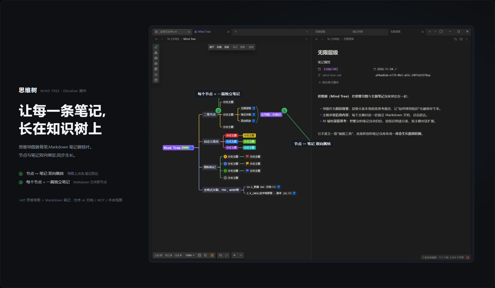
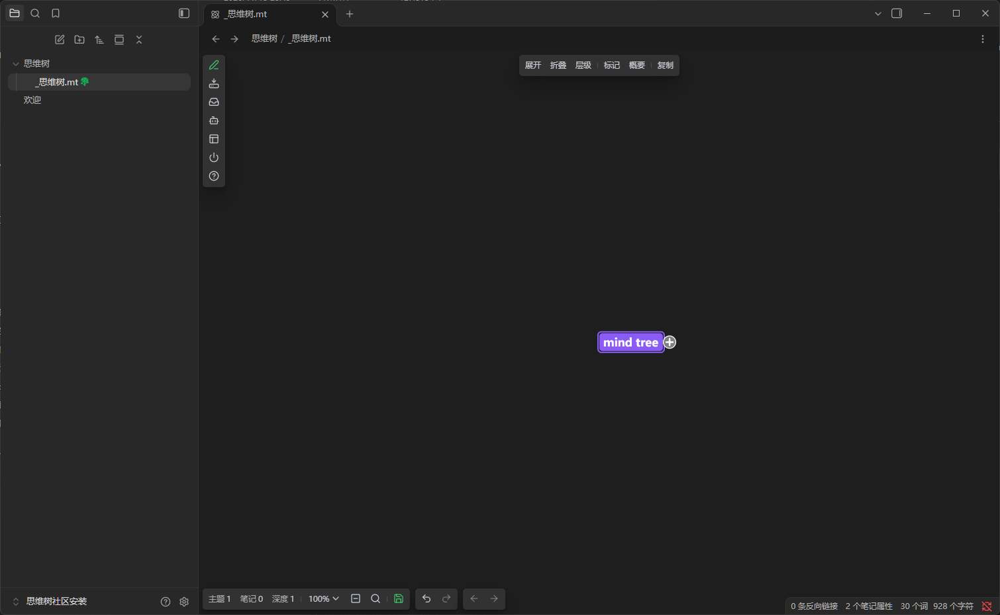

# Mind Tree · 思维树

**AI-driven mind mapping and topic notes — every action sparks deeper thinking, and knowledge grows like a tree.**

[User Manual](https://flowus.cn/jzcy/share/4ce27dd8-615f-4398-aef4-eb0dce751249?code=C5ZPWU) · [Feedback](https://flowus.cn/jzcy/share/3f2d9d16-0085-43b1-9b78-c721a1574d82?code=C5ZPWU) · [Bilibili](https://space.bilibili.com/481011622)

[简体中文](README.zh-CN.md) | English

---

## What Is This

**Mind Tree (思维树)** is an [Obsidian](https://obsidian.md) plugin that deeply binds **mind maps** and **topic notes** together:

- The map is your **knowledge skeleton**: the hierarchical classification itself is the path of thinking, so "how the knowledge was derived" is preserved too.
- Topics carry the **information content**: each topic maps to a standalone note, one click away.

It's not another "drawing tool" — it turns your vault into a **growing tree of knowledge**.

**Basic feature demo:**

---

## Core Features

### 1. Mind Map Editor

- **Full map editing**: drag to rearrange hierarchy, full-text search, keyboard navigation, clean rainbow connector lines, multiple layouts and color themes, export and share.
- **Dark / light theme**: syncs automatically with the Obsidian theme.

### 2. Topic Notes

- **One topic, one note**: click a topic on the map to jump straight to its note; how notes link back to topics requires no manual upkeep — the plugin maintains the bidirectional index automatically.
- **Configurable open behavior**: open on click or on icon click, with a choice of where it opens.
- **Node marks**: progress, priority, card type, level (realm), knowledge entity, highlight and more — each can be toggled independently in settings.
- **Topic note templates**: new topics can carry default content, compatible with Templater dynamic syntax.
- **Visual note properties**: the note's property labels are shown directly on map nodes, with customizable colors and icons.

---

## Settings (Seven Tabs)

Settings are grouped into tabs by feature:

- **General**: how to handle notes not yet in Mind Tree, auto-collection exclusion rules, whether to auto-link to the root topic.
- **Mind Map**: default theme, expand level on open, title wrap width, default read-only mode, auto-save, mouse wheel / left-right button behavior, mark count and position.
- **Topic Notes**: open behavior and location, default content, template path, node mark toggles.
- **Knowledge Management**: knowledge-base manager toggle, knowledge type and property configuration.
- **More Settings**: import folder location, GET note authorization, log level, debug options.
- **Premium**: license code management and activation (hidden together with author info when the author info is hidden).
- **About**: philosophy, WeChat official account, Bilibili, user manual, feedback channels.

---

## Installation

### Option 1: From the Obsidian Community Plugins Marketplace

Now available: [Mind Tree](https://community.obsidian.md/plugins/mind-tree) on the marketplace. In Obsidian, open Settings → Community plugins → Browse, search for "Mind Tree", and install.

### Option 2: Manual Installation

1. Download the latest `main.js`, `manifest.json`, and `styles.css` from the [release page](https://flowus.cn/jzcy/share/4ce27dd8-615f-4398-aef4-eb0dce751249?code=C5ZPWU).
2. Create the directory `.obsidian/plugins/mind-tree/` in your Obsidian vault.
3. Put the three files into that directory.
4. Enable "Mind Tree" in Obsidian settings → Community plugins.

> Desktop only (mobile not yet supported).

---

## Contact Us

- **WeChat Official Account**: 瑾智初源
- **Bilibili**: [思维树·Mind Tree](https://space.bilibili.com/481011622)
- **User Manual**: [FlowUs docs](https://flowus.cn/jzcy/share/4ce27dd8-615f-4398-aef4-eb0dce751249?code=C5ZPWU)
- **Feedback**: [feedback channel](https://flowus.cn/jzcy/share/3f2d9d16-0085-43b1-9b78-c721a1574d82?code=C5ZPWU)
- **Purchase License**: [get VIP](https://flowus.cn/jzcy/share/66cedaaa-a8b6-456b-b536-d0f341b467ed?code=C5ZPWU)

---

## License

MIT License · Author: 瑾智初源
